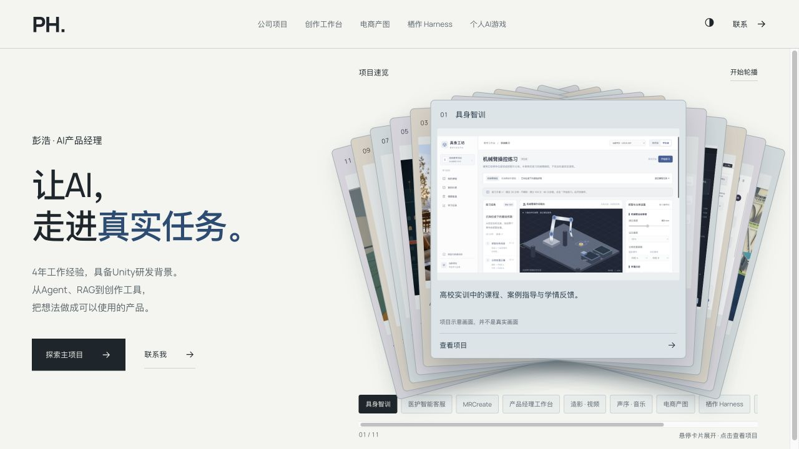

# 彭浩 · AI产品作品集

个人作品集网页源码。围绕 Agent、RAG、AI创作工具与Unity互动体验，展示五个模块、十一项产品与作品。

- **在线预览：** https://hao2048.github.io/penghao-ai-portfolio/
- **原作品集地址：** https://penghao-ai-portfolio.epicheron6.chatgpt.site/



## 本地运行

无需安装npm依赖或构建。克隆后使用静态HTTP服务器启动：

```bash
git clone https://github.com/Hao2048/penghao-ai-portfolio.git
cd penghao-ai-portfolio
python3 -m http.server 8080
```

浏览器打开 **http://localhost:8080/**。请使用HTTP服务器，不要直接双击`index.html`；案例详情需要通过`fetch`读取本地JSON。

## 项目内容

| 模块 | 项目 |
| --- | --- |
| 公司项目 | 具身智训、医护智能客服、MRCreate |
| 创作工作台 | 产品经理工作台、造影视频工作台、声序音乐工作台 |
| 电商产图 | 商品场景图助手 |
| 栖作 Harness | 多角色协作与交付工作环境 |
| 个人AI游戏 | 漫游星空、云上列车、老板来了 |

## 文件结构

```text
index.html                    页面内容与媒体引用
showroom.css                  展示样式与响应式布局
showroom.js                   速览卡牌、媒体切换、音频与案例弹窗
scene-navigation.js           整屏模块、项目分页与同步介绍
resume-data.json              完整案例内容
project-introductions.json    各项目背景、目标用户、解决的问题
assets/                       本地图片、视频、音频、字体与字体许可
demos/robotlab/                随仓库附带的具身智训交互原型
docs/                         预览图、素材说明与完整资源清单
scripts/check_assets.py       本地资源、页面锚点和敏感配置检查
.nojekyll                     GitHub Pages直接发布静态文件
```

## 展示与操作

- 首页使用旋转重叠卡牌，支持自动轮播、悬停选择和暂停。
- 模块使用整屏换幕，模块内项目分页；介绍与画面同步显示。
- 教学原型直接随仓库提供，可放大操作；工作台、配置页面和成图可切换查看。
- 视频与音乐使用本地媒体文件，点击播放即可使用；包含小机器人、纸花及《绿野之风》等示例。
- 支持浅/深色模式、键盘导航及系统减少动态效果设置。

## 资源完整性

所有运行必需的图片、视频、音频、字体、案例JSON和内嵌原型都随仓库提交，不依赖作者电脑上的路径、临时下载链接或外部CDN。浏览器不需要API密钥。

```bash
python3 scripts/check_assets.py
```

检查器会核对HTML、CSS、JavaScript本地引用及随附资源清单。部署到其他静态站点时，保留现有相对目录结构即可。

## 演示边界与素材说明

公司项目画面按展示要求标注为“项目示意画面，并不是真实画面”。具身智训使用本地/合成数据，未连接真实教务系统；演示中的助教与分析交互不代表连接了真实模型服务。MR场景参考图为AI生成概念图。个人项目画面与音视频为作品演示素材。

字体许可及素材来源见 [docs/ASSETS.md](docs/ASSETS.md) 与 [assets/FONT-LICENSE.txt](assets/FONT-LICENSE.txt)。仓库公开展示不代表所有图片、音视频和第三方素材已授予无限制商用许可。
